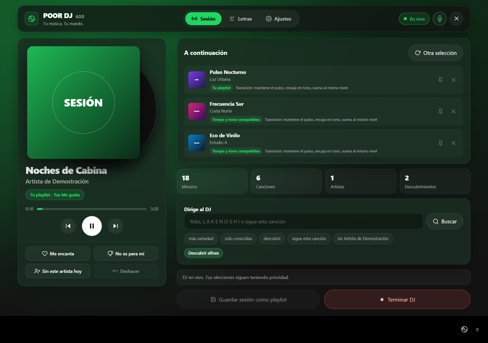
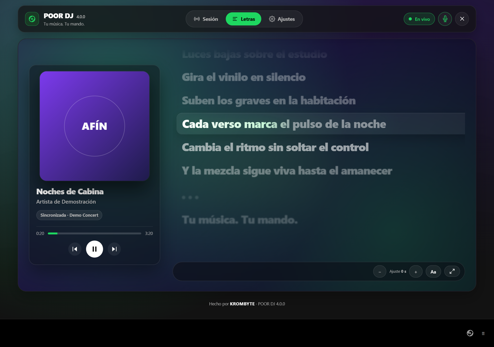

<div align="center">


# POOR DJ

**Tu música. Tu mando.**  
*Cabina de DJ local, escenario de letras y voz neuronal en español para Spotify con Spicetify.*

[](CHANGELOG.md)
[](LICENSE)
[](manifest.json)
[](#privacidad-y-funcionamiento-local)
[](package.json)
[](VALIDATION.md)

Hecho por **KROMBYTE** · Cabina completa en `/PoorDJ` · Cero dependencias externas en el cliente

[Características](#-características-principales) · [Concert Lyrics](#-escenario-de-letras-concert-stage) · [Voz Neuronal](#-voz-neuronal-local-en-español) · [Comandos](#-dirigir-el-dj-en-español) · [Atajos](#-atajos-de-teclado) · [Instalación](#-instalación) · [Licencia](#-licencia)

</div>

---

<p align="center">
  
</p>

<p align="center"><sub>Captura generada con datos de demostración locales. No corresponde a una cuenta real de Spotify.</sub></p>

## ✨ Características principales

- **Cabina translúcida (`/PoorDJ`):** fondo ambiental tintado dinámicamente con la portada actual, vinilo giratorio animado, estadísticas de sesión en vivo y cierre limpio con `X`, `Esc`, `Ctrl+D` o el botón de la barra (con retorno seguro incluso en historial raíz).
- **Resistencia real a saltos y prioridad manual:** saltar varias canciones seguidas nunca apaga el DJ. Si añades canciones manualmente a la cola, POOR DJ retira sus propuestas de inmediato para que lo tuyo suene primero y retoma la mezcla al terminar.
- **Gusto musical inteligente y cero repeticiones:** combina tus *Me gusta*, playlists e historial con la radio interna de Spotify (`inspiredby-mix` / `radio-apollo`), aprende afinidad por artista, respeta espaciado entre artistas y bloquea duplicados (`Remastered`, `Live`, `feat.`).
- **Transiciones cuidadas:** prioriza continuidad de tempo, tonalidad y sonoridad, con control explícito del *crossfade* nativo de Spotify y recuperación de volumen.
- **Voz neuronal local en español (`voice/`):** locutor local con **Piper** y **Kokoro ONNX** en `127.0.0.1:47811` que baja suavemente la música (*ducking*) sin detenerla, acompañado de subtítulos en tiempo real.

---

## 🎤 Escenario de letras (Concert Stage)

<p align="center">
  
</p>

- **Diseño inmersivo a dos columnas:** aura animada con la portada actual, tarjeta lateral fija (*Ahora suena*, insignia de proveedor, barra de progreso interactiva y transporte compacto) y columna principal centrada automáticamente.
- **Iluminación línea a línea y profundidad:** el verso actual escala e ilumina progresivamente el texto de izquierda a derecha según el tiempo exacto de reproducción, las líneas lejanas se difuminan con suavidad y al pasar el cursor revelan su marca de tiempo para saltar con un clic.
- **Modo cine (`Pantalla completa`):** oculta barra superior y pie para dejar solo el aura, portada y letras a pantalla completa, con esqueletos *shimmer* de carga, puntos instrumentales animados y ajuste fino de sincronización (`±0.25 s`).
- **Compatible con tu extensión de letras favorita:** si usas **Spicy Lyrics**, **Lyrics Plus** o **Beautiful Lyrics**, puedes elegir desde **Ajustes → Apariencia y letras** abrirla por defecto (`↗`) o usar el escenario integrado de POOR DJ.

---

## 🎛️ Modos de mezcla, búsqueda y artistas

Elige el rumbo de cada sesión desde **Empieza tu sesión**:

| Modo | Qué mezcla |
| --- | --- |
| **Mis favoritas** | Solo canciones de tus playlists, *Me gusta* y escuchas verificadas. |
| **Mezcla** *(predeterminado)* | Equilibrio entre tu biblioteca conocida y recomendaciones afines de Spotify. |
| **Descubrir** | Amplía con radio de Spotify y artistas relacionados sin repetir versiones. |

También puedes buscar cualquier artista para crear mezclas guardadas como playlist privada en tu cuenta:

| Modo de artista | Comportamiento |
| --- | --- |
| **Aleatorio** | El artista como eje central, intercalado con canciones y artistas afines. |
| **Artista** | Solo canciones acreditadas al artista, incluidas sus colaboraciones. |

<p align="center">
  
</p>

---

## 🗣️ Dirigir el DJ en español

Todas las instrucciones se interpretan localmente en lenguaje natural sin enviar texto a servidores externos:

| Comando | Acción |
| --- | --- |
| `solo conocidas y más variedad` | Limita la mezcla a tu colección y amplía el espaciado entre artistas. |
| `permite descubrir y sin Dillom` | Activa recomendaciones afines y excluye a ese artista durante la sesión. |
| `sigue esta canción` | Toma la canción que suena como ancla e inicia la sesión del DJ. |
| `pon SIN UN PLAN (TEGOCALDERON) de Isma` | Busca la canción exacta y sigue tu regla (*Seguir dirección* o *Pausar DJ*). |
| `termina el DJ` | Detiene la sesión limpiamente y restaura cualquier cola previa suspendida. |

---

## 🎙️ Voz neuronal local en español

Para sustituir las voces genéricas del sistema por locución neuronal local de baja latencia en **Windows**:

```powershell
powershell -ExecutionPolicy Bypass -File voice\install.ps1 -Autostart
```

- Añade `-Kokoro` para instalar también las voces opcionales de **Kokoro ONNX** (`em_alex`, `em_santa`, `ef_dora`) junto a las de **Piper** (`es_MX-claude-high` por defecto, `es_MX-ald-medium`, `es_AR-daniela-high`, `es_ES-davefx-medium`).
- `-Autostart` registra el arranque silencioso en segundo plano (`POOR DJ Voz`) al iniciar sesión; puedes controlar el servicio manualmente con `voice\start.ps1`, `voice\stop.ps1` o probar las voces con:

```powershell
voice\.venv\Scripts\python.exe voice\server.py --selftest
```

- Si el servidor neuronal no está encendido, POOR DJ usa la voz local disponible del sistema o muestra los comentarios por escrito.

---

## ⌨️ Atajos de teclado

| Atajo | Acción |
| --- | --- |
| **`Ctrl + D`** | Abre o cierra la cabina **POOR DJ** desde cualquier vista de Spotify. |
| **`Esc`** | Sale de pantalla completa en Letras o cierra la cabina limpiamente. |
| **`←` / `→`** *(sobre pestañas)* | Alterna entre *Sesión*, *Letras* y *Ajustes*. |

---

## 🛡️ Privacidad y funcionamiento local

- Todo tu aprendizaje musical, exclusiones, favoritos detectados y preferencias permanecen almacenados localmente en tu cliente (`poor-dj-v3` / esquema 4).
- El servidor local de voz escucha **exclusivamente en `127.0.0.1:47811`** y sintetiza audio en CPU sin claves API ni nube.
- Las consultas musicales usan únicamente tu sesión local de Spotify; **LRCLIB** para letras externas está desactivado por defecto y solo consulta título, artista, álbum y duración si decides activarlo en Ajustes.

---

## 🚀 Instalación

1. Copia [`poor-mans-dj.js`](poor-mans-dj.js) en la carpeta `Extensions` de Spicetify (`%APPDATA%\spicetify\Extensions\`).
2. Registra y aplica la extensión:

```sh
spicetify config extensions poor-mans-dj.js
spicetify apply
```

3. Haz clic en el icono de disco junto a la cola en Spotify o presiona **`Ctrl+D`** para abrir la cabina.

---

## 🛠️ Desarrollo y pruebas

Requiere **Node.js >= 24** (el paquete final `poor-mans-dj.js` no tiene dependencias externas):

```sh
node build.cjs
node --check poor-mans-dj.js
node --test --test-isolation=none test/*.test.cjs
node test/ui.smoke.cjs
node release.cjs
```

Consulta [VALIDATION.md](VALIDATION.md), [CHANGELOG.md](CHANGELOG.md), [CONTRIBUTING.md](CONTRIBUTING.md) y [PUBLISHING.md](PUBLISHING.md) para más detalles.

---

## 📄 Licencia

Distribuido bajo la licencia **GNU Affero General Public License v3.0 (AGPL-3.0)** — consulta [LICENSE](LICENSE) para ver el texto completo.

> Proyecto independiente hecho por **KROMBYTE**, sin afiliación con Spotify ni Spicetify.
